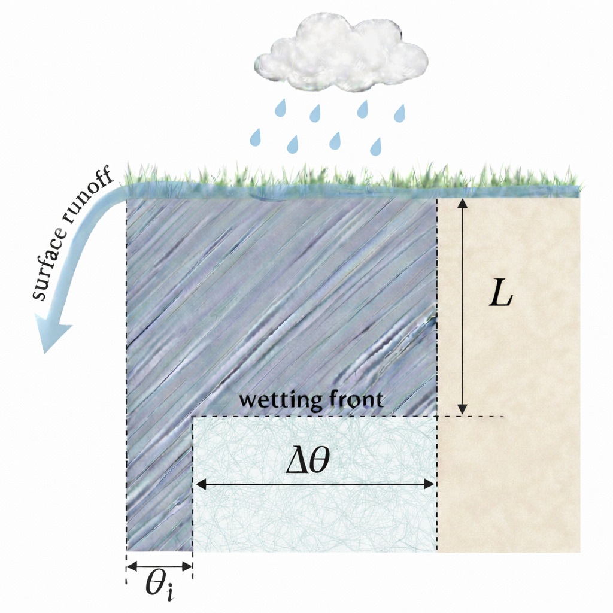
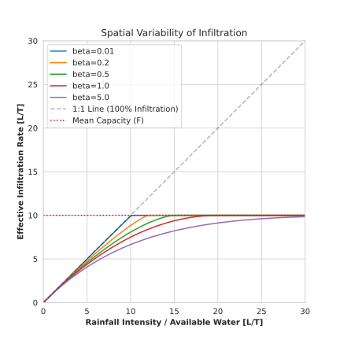

# Soil Water

The soil module has 6 soil layers, following the convention of the SoilGrids database[@poggio2021soilgrids].

| Layer | Depth  |
|-------|--------|
| 1     | 0-5cm  |
| 2     | 5-15cm |
| 3     | 15-30cm|
| 4     | 30-60cm|
| 5     | 60-100cm|
| 6     | 100-200cm|

For each grid cell and layer, we collect the following variables from SoilGrids:

| Variable              | Soilgrids variable |
|-----------------------|-------------------|
| Bulk density          | bdod              |
| Clay                  | clay              |
| Silt                  | silt              |
| Sand*                 | sand              |
| Soil organic carbon   | soc               |

!!! note

    Sand is not actually obtained, but implied through `100% - Silt (%) - Clay (%)`.

Based on the basic soil properties (sand, clay, silt, organic carbon, bulk density), several hydraulic parameters are derived using Pedotransfer Functions (PTFs).

| Parameter | Symbol | Source / Method |
|-----------|--------|-----------------|
| Saturated water content | $\theta_s$ | Toth et al. (2015)[@toth2015new] |
| Residual water content | $\theta_r$ | Brakensiek et al. (1984)[@rawls1989estimation] |
| Saturated hydraulic conductivity | $K_{sat}$ | Wösten et al. (1999)[@wosten1999development] |
| Bubbling pressure | $h_b$ | Rawls and Brakensiek (1989)[@rawls1989estimation] |
| Pore size distribution index | $\lambda$ | Rawls and Brakensiek (1989)[@rawls1989estimation] |

Field capacity ($\theta_{fc}$ at pF 2.0) and wilting point ($\theta_{wp}$ at pF 4.2) are subsequently calculated from the soil water retention curve defined by these parameters. The top 30cm of the soil is considered topsoil, following the FAO Harmonic World Soil Database conventions.

## Infiltration and surface runoff

We implement an infiltration scheme based on the Green-Ampt equation[@green1911studies], solving for infiltration capacity physically based on soil properties and moisture deficit.

The Green-Ampt method[@green1911studies] conceptualizes infiltration as a sharp wetting front moving downwards through the soil column. As rain falls, a saturated zone develops at the surface and extends to a depth $L$, known as the *wetting front*. Above this front, the soil is assumed to be fully saturated, while below it, the soil remains at its initial moisture content ($\theta_i$). The difference between saturation and the initial moisture is the moisture deficit $\Delta \theta$.

The driving force for water movement is a combination of gravity and the matric suction (capillary forces) at the wetting front. Initially, when the wetting front is shallow, the suction gradient is high, leading to rapid infiltration. As the front moves deeper (increasing $L$), the suction gradient decreases, and the infiltration rate asymptotically approaches the saturated hydraulic conductivity ($K_{sat}$). If rainfall intensity exceeds this capacity, the excess water generates surface runoff.

The model determines the maximum infiltration capacity ($f_{cap}$) for the current timestep using the explicit Green-Ampt approximation[@sadeghi2024simple]. This avoids the need for iterative solutions or sub-stepping typically required for the implicit Green-Ampt formulation.

The cumulative infiltration $I(t)$ is calculated as:

$$ I(t) = K_{sat} t \left( 0.70635 + 0.32415 \sqrt{1 + 9.43456 \frac{S^2}{K_{sat}^2 t}} \right) $$

Where:
* $I(t)$ is the cumulative infiltration [$L$].
* $K_{sat}$ is the saturated hydraulic conductivity [$L/T$].
* $S^2 = 2 K_{sat} \psi_f \Delta \theta$ is the square of sorptivity [$L^2/T$][@philip1969theory].
* $\psi_f$ is the wetting front suction head [$L$].
* $\Delta \theta$ is the moisture deficit [$ - $].
* $t$ is the time since the start of the infiltration event [$T$].

The model tracks the wetting front depth ($L$). At the beginning of each timestep, the "effective time" ($t_{eff}$) corresponding to the current wetting front is calculated by inverting the standard Green-Ampt equation (exact analytical inversion). The potential cumulative infiltration at $t_{eff} + \Delta t$ is then calculated using the explicit formula above. The difference determines the maximum infiltration capacity for the timestep.

$$f_{cap} = I(t_{eff} + \Delta t) - I(t_{eff})$$

### Spatial Variability of Infiltration

In hydrological modeling, assuming a uniform infiltration capacity and uniform rainfall across a grid cell often leads to an underestimation of surface runoff. Even when the average rainfall intensity is lower than the average infiltration capacity, localized areas within the cell may still generate runoff, for example due to spatial heterogeneity in soil properties (e.g., compaction, crusting), variations in vegetation cover, or sub-grid rainfall variability.

To address this, we use the **Probability Distributed Model (PDM)** principle described by Moore (1985)[@moore1985probability]. Instead of a single value, the infiltration capacity within a cell is assumed to follow a spatial probability distribution, specifically a Reflected Power (or Power-Law) distribution, controlled by a shape parameter beta ($\beta$).

This distribution defines the fraction of the cell area $F(f)$ that has an infiltration capacity less than or equal to $f$:

$$ F(f) = 1 - \left(1 - \frac{f}{f_{max}}\right)^{\beta} $$

Where $f_{max}$ is the maximum local infiltration capacity, related to the mean Green-Ampt capacity ($f_{GA}$) by $f_{max} = f_{GA} \cdot (\beta + 1)$.

The effective infiltration rate for the cell is obtained by integrating this distribution. This allows the model to generate Hortonian runoff from partial areas of the cell even when the mean rainfall intensity is less than the mean infiltration capacity.

### Runoff generation

If the rainfall intensity exceeds this capacity, Hortonian (infiltration excess) runoff is generated.

Infiltration is also limited by the available pore space in the soil column. The model calculates the available storage in the active soil layers (layers reached by the wetting front). If the soil becomes saturated (reaches $W_s$), no further infiltration can occur, and any additional water serves as saturation excess runoff (Dunne runoff).

The actual infiltration for a timestep is determined by the minimum of:

1. The available water on the surface (precipitation + accumulated topwater) [$L$].
2. The Green-Ampt infiltration capacity ($f_{cap}$) [$L$].
3. The available storage in the soil column (up to the wetting front depth or bottom of soil) [$L$].

Any water that does not infiltrate contributes to surface runoff.

## Vertical flow

Redistribution of water between soil layers uses a finite volume solution to the Richards equation[@richards1931capillary]. The flux $q$ between two layers is calculated using Darcy's Law[@darcy1856fontaines]:

$$
q = -K(\theta) \left( \frac{\partial \psi}{\partial z} - 1 \right)
$$

where $z$ is the vertical coordinate (positive upwards) and the $-1$ term accounts for gravity. The hydraulic conductivity $K(\theta)$ and matric potential $\psi(\theta)$ are defined by the Van Genuchten-Mualem relationships. First, the effective saturation $S_e$ is calculated:

$$
S_e = \frac{\theta - \theta_r}{\theta_s - \theta_r}
$$

where $\theta$ is the volumetric water content, $\theta_s$ is the saturated water content, and $\theta_r$ is the residual water content. The matric potential and unsaturated hydraulic conductivity are then given by:

$$
\psi(S_e) = -\frac{1}{\alpha} \left( S_e^{-1/m} - 1 \right)^{1/n}
$$

$$
K(S_e) = K_{s} \sqrt{S_e} \left[ 1 - \left(1 - S_e^{1/m}\right)^m \right]^2
$$

Here:

* $K_s$ is the saturated hydraulic conductivity.
* $\alpha$, $n$, and $m$ are shape parameters, where $m = 1 - 1/n$.
* The parameter $\alpha$ is related to the bubbling pressure $h_b$ (in cm) by $\alpha = 100/h_b$ (converting to m$^{-1}$).

!!! note

    When there is an active wetting front, the vertical flow described here is turned off.

## Interflow

Interflow, or lateral subsurface flow, is the movement of water within the soil profile parallel to the land surface. In GEB, interflow is calculated for each soil layer when the soil moisture content exceeds the field capacity. This "free water" is available to move laterally driven by gravity and the slope of the terrain, and then added to the channel in each grid cell.

### Kinematic Wave Approximation

The interflow calculation conceptualizes the hillslope as a draining reservoir. The rate of drainage is determined by the **kinematic wave approximation** for saturated subsurface flow[@sloan1984modeling]. This approach assumes that the hydraulic gradient is approximately equal to the land surface slope and that flow lines are parallel to the soil-bedrock interface.

The physical derivation follows these steps:

1.  **Kinematic Flux**: The discharge per unit width $q$ ($m^2/h$) is defined as:

    $$q = K_{lat} H_w \sin(\beta)$$

    where $H_w$ is the saturated thickness ($m$) and $\beta$ is the slope angle.
2.  **Conversion to storage**: To integrate this into a grid-based volume balance, the saturated thickness $H_w$ is expressed in terms of the "free water" depth ($W_{free}$ in meters) and the drainable porosity ($\phi_d$):

    $$H_w = \frac{W_{free}}{\phi_d}$$

3.  **Hillslope integration**: In the kinematic storage model the saturated zone is a wedge that is twice as thick at the foot of the hillslope as on average. The interflow depth produced by a hillslope of length $L$ is the discharge at its foot divided by that length:

    $$\text{Interflow} = \frac{2 K_{lat} \sin(\beta) W_{free}}{\phi_d L}$$

    This holds while the wedge stays inside the soil, up to half filling of the drainable pores. Above that the saturated zone reaches the top of the soil at the foot of the hillslope and cannot get thicker there, so the interflow stays at its value at half filling. The additional water widens the saturated area (see below). The rule is applied to each soil layer.

Interflow is the outflow at the foot of the hillslope, so it enters the channel without a further delay.

### Lateral conductivity

Lateral flow on hillslopes is carried mostly by the structure of the soil (root and animal channels, pipes, loose aggregated topsoil) and not by the soil matrix. The lateral conductivity of each layer is the sum of the matrix conductivity and a structural part that is largest at the surface and declines exponentially with depth $z$:

$$
K_{lat}(z) = K_{matrix}(z) + K_{structure} \, e^{-z / d}
$$

* $K_{structure}$: Structural lateral conductivity at the surface, by land cover (`interflow_structural_conductivity_m_per_day`: forest 100, grassland 50, cropland 15 m/day). Forest soils have the best developed structure; tillage destroys it in cropland.
* $d$: e-folding depth of the structural conductivity (`interflow_structural_depth_m`, 2.0 m: the soil and the weathered zone below it).
* $\phi_d$: Drainable porosity ($-$).
* $L$: Hillslope length ($m$).

Because the conductivity is concentrated near the surface, interflow rises steeply when the upper layers fill with free water.

### Saturated area

Rain on land that is saturated to the surface cannot enter the soil and runs off. The saturated area follows from the same hillslope store (Sloan and Moore, 1984): the saturated zone is a wedge that is thickest at the foot of the slope. While the drainable pores of the structured soil (the layers within the depth $d$) are less than half full, the wedge stays below the surface. Above that it reaches the surface over the lower part of the slope:

$$
A_s = \max(0, \; 2 S - 1)
$$

* $A_s$: Fraction of the land that is saturated to the surface ($-$).
* $S$: Filling of the drainable pores of the structured soil with perched water, 0 when empty and 1 when saturated ($-$).

The saturated zone builds up from below: free water over a layer that still takes up water is on its way down and not part of a saturated zone. The free water of a layer therefore counts as perched in proportion to the filling of the drainable pores of the layer below it (the lowest soil layer rests on the rock). This is the same water that drains sideways as interflow. Early in an event rain on a soil with room below does not run off as saturation excess; once the profile has filled from below it does.

There is no shape parameter. Land where the groundwater table reaches the surface is saturated as well.

$L_{hill}$ is derived from the drainage density ($D_d$) of the river network:

$$ L_{hill} = \frac{1}{2 D_d} $$

The drainage density is calculated by summing the length of all streams (defined as pixels with more than 0.2 km² upstream area, `channel_initiation_area_km2` of `setup_geomorphology`) within the grid cell and dividing by the cell area. This network is denser than the routing network, whose streams start at 1 km². To avoid unrealistic values in areas with sparse river networks, the hillslope length is capped at 1000 m.

## Groundwater percolation

Water percolates from the bottom soil layer to the groundwater through two mechanisms:

1.  Direct recharge: If the wetting front extends beyond the bottom of the soil profile (e.g., during intense rainfall), the calculated infiltration flux directly recharges the groundwater.
2.  Gravity drainage: In the absence of an active wetting front reaching the bottom layer, water drains from the lowest soil layer driven by gravity. The drainage flux $q_{bottom}$ is assumed to be equal to the unsaturated hydraulic conductivity of the bottom layer ($K(\theta_{bottom})$), representing a unit hydraulic gradient condition.

If water is rising from the groundwater, percolation is suppressed.

## Code

::: geb.hydrology.landsurface.water
